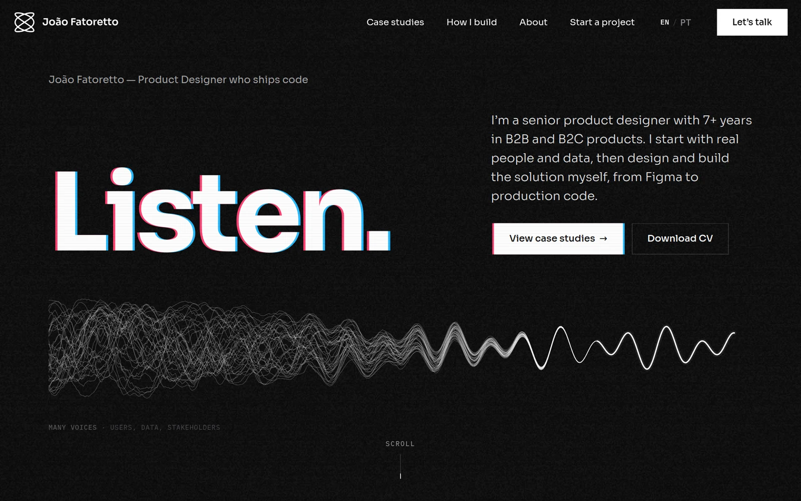
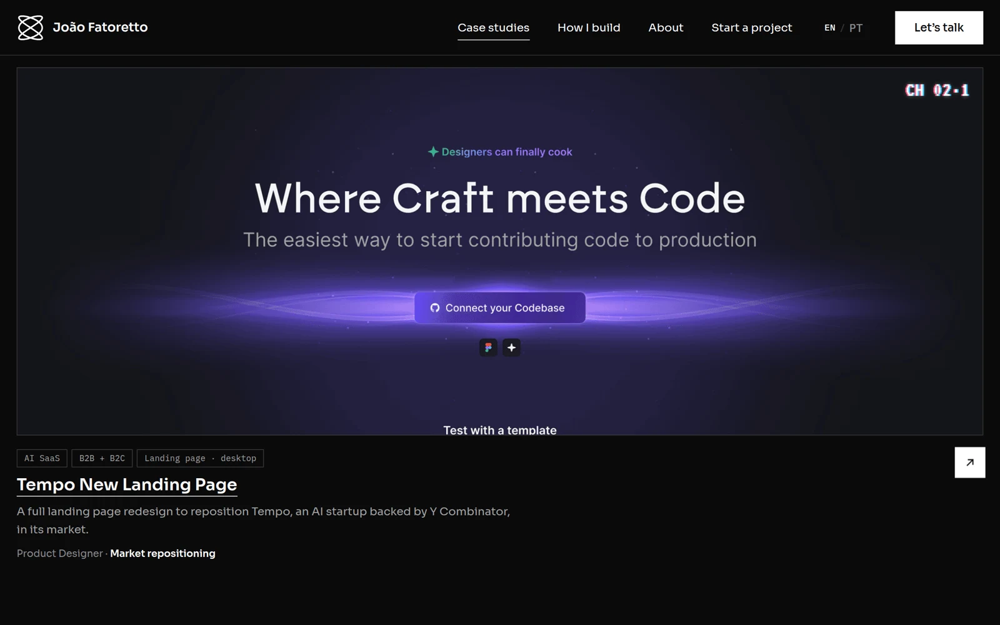
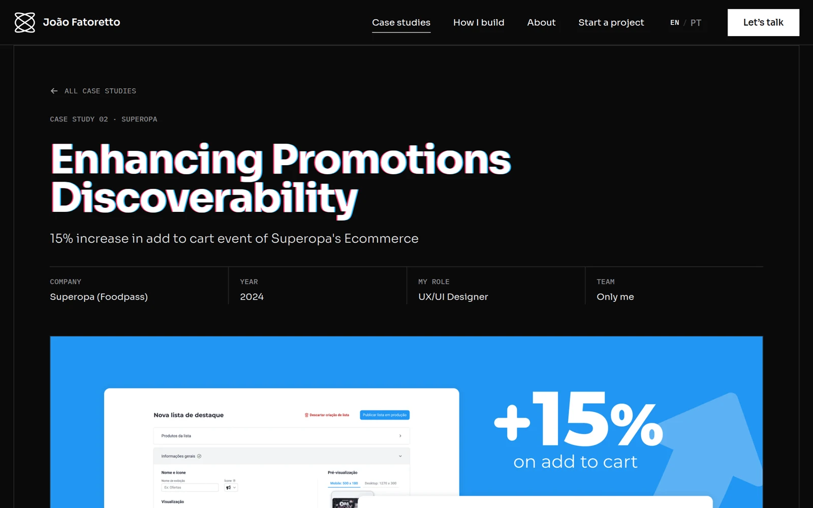
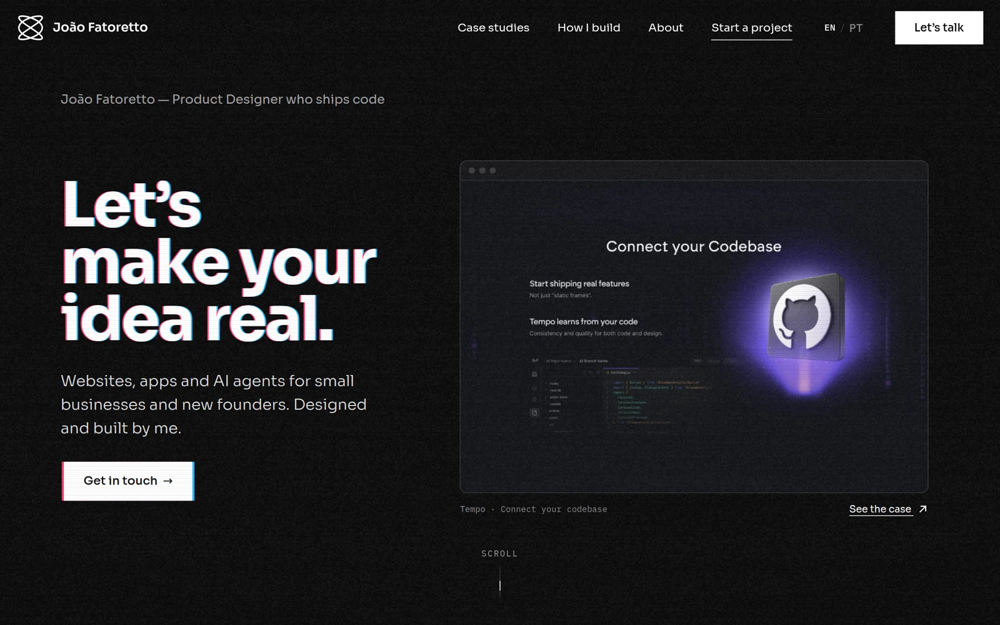

<div align="center">

<a href="https://joaofatoretto.com">
  
</a>

# João Fatoretto

**Product designer who ships code.** This is the source of my portfolio.

[**joaofatoretto.com →**](https://joaofatoretto.com) · [LinkedIn](https://www.linkedin.com/in/joaovitorfatoretto/) · [CV](https://joaofatoretto.com/cv/joao-fatoretto-cv.pdf) · jvitorfatto@gmail.com

</div>

---

## Hi, I'm João

I started as a developer in 2017, moved into design in 2018, and have spent the years since going back and forth between the two. I studied Computer Science at UNICAMP, ran its student software consultancy as president, and now do product design for a US healthcare client while building my own AI products on the side. I work with Claude Code every day.

That mix is why this site isn't a template. I designed it, wrote it and tested it myself, so it doubles as a sample of how I work.

## What to look at

| | |
|---|---|
|  |  |
| **Case studies**: each with the problem, my role and the measured result up top. | **One template, content-driven.** Adding a case means adding one file; tests check the images, alt text and summaries. |



**[/hire](https://joaofatoretto.com/hire)** is a second landing page, for small businesses and founders who want something built. Same engine, different audience.

<br clear="right">

## Decisions I'm happy with

- **A brand, not a theme.** [`design.md`](design.md) defines the visual language (Frequency); the CSS tokens mirror it, and when the two disagree the document wins.
- **Motion with a point.** Everything that moves is a TV metaphor (tuning in, changing channel), and all of it switches off for `prefers-reduced-motion`.
- **Fast and shareable.** Every page is prerendered to static HTML with its own title, Open Graph image and JSON-LD, then hydrated.
- **English and Brazilian Portuguese.** Every string lives in `src/content/`, and the type checker fails the build if one language is missing a key.
- **Tested behaviour.** Vitest covers content, hydration and the lead form's validation.
- **Written down.** [`docs/`](docs) records who the site is for and why each section exists.

## Stack

Vite · React 19 · TypeScript · React Router 7 · hand-written CSS · a Vercel Function with Resend for the contact form · hosted on Vercel.

```bash
npm install
npm run dev      # localhost:5173
npm test
npm run build    # typecheck + prerender
```

---

© 2026 João Fatoretto. All rights reserved: the repo is public so you can see how the site is built, not to be copied or reused. See [LICENSE](LICENSE).
